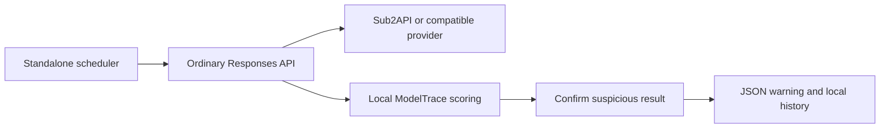

# ModelTrace Monitor

[中文](README_CN.md) · [Configuration](CONFIGURATION.md) · [Contributing](CONTRIBUTING.md)

A standalone, warning-only model-fingerprint monitor for OpenAI-compatible **Responses APIs**. Schedule probes, score outputs locally with ModelTrace, repeat suspicious results, and log warnings for human review.

**No gateway fork, backend patch, admin API key or database access.** It works as a separate Node.js process with a normal inference API key. It never suspends accounts.

Experimental: local mock-based tests pass; live-account identification accuracy has not been measured. A warning indicates similarity to another reference candidate, not proven model substitution.

## Quick start

Requires Node.js 22+ on Linux or macOS. No npm dependencies are required.

```sh
git clone https://github.com/griffinzhai917/modeltrace-monitor.git
cd modeltrace-monitor
npm test
npm run check
```

The example is disabled. `--check` verifies configuration and reference checksums **without sending requests**.

Copy `config.example.json` to a protected runtime directory outside the checkout. Configure an API base URL such as `https://your-gateway.example/v1`, a model from the reference bank, a target ID and the environment variable containing its ordinary API key. Set `enabled: true` when ready. Inject keys through your runtime's secret mechanism; never put them in JSON or Git.

```sh
node src/cli.mjs --check /path/to/runtime/config.json
node src/cli.mjs --once /path/to/runtime/config.json
node src/cli.mjs --run /path/to/runtime/config.json
```

`--once` and `--run` consume inference quota. Each eligible target needs three requests, or six when confirmation is necessary. A configured request-count budget is not a token or currency budget.

## Using it with Sub2API

Use the **original, unmodified** Sub2API installation and its normal API key. The monitor only posts to `/responses` under the configured API base URL; it does not call `/admin` endpoints.

To check a particular account, configure a dedicated group whose effective routing is restricted to that one account, then use a key for that group. Disable or avoid fallback routes that select other accounts. Repeat for each account you want to monitor.

**The monitor cannot verify account pinning.** A target ID is a local label, not a server-side account selector. If a key can route to several accounts or a model mapping changes the requested model, results describe that route rather than one specific account. This external approach also cannot detect account-configuration changes during a cycle.

## How it works



1. Probe each configured target with three separate requests. Each asks the model itself for 292–332 integers in 1–355, without tools.
2. Reject truncated, malformed, sorted, cyclic, duplicate or otherwise invalid samples.
3. Compare the outputs with the pinned ModelTrace reference bank. All three individual winners must agree; the combined winner must differ from the requested model and meet configured thresholds.
4. Wait, repeat three probes, and warn only if both rounds agree on the same alternate candidate.
5. Keep the target available. The operator decides what to do.

Logs go to stdout. The latest 200 records are saved in `state_dir/history.json` with timestamps, scores, reference hashes and sanitized diagnostic codes. Raw prompts, raw responses and keys are not stored. No dashboard, email or mobile push is included.

The schedule is anchored to startup. Long cycles skip missed ticks; there are no overlapping runs or catch-up bursts. A local lock prevents duplicate processes sharing the same state directory. It is not a distributed lock.

## Compatibility and limitations

- Only the Responses protocol is implemented; Chat Completions and native Anthropic Messages are not implemented.
- Both completed SSE and completed JSON Responses are accepted. The configured key must be valid for the endpoint.
- Unknown models are skipped without inference requests. The bundled bank has 18 candidates and does **not** include `gpt-6.1-sol`.
- The bank contains model-specific fingerprints, not a universal detector. Relative probabilities are not calibrated identity probabilities.
- Context, prompt wording, reasoning effort, backend changes and new model versions can shift fingerprints. Confirmation does not eliminate persistent false positives.
- A fresh HTTP probe cannot prove which model served an earlier WebSocket or long-context request.
- Gateway updates require no source merge, but compatibility still depends on the endpoint, routing and reference data remaining suitable.

Full field reference and operations: [CONFIGURATION.md](CONFIGURATION.md).

## Container

```sh
docker build -t modeltrace-monitor:local .
docker run --rm modeltrace-monitor:local
```

The default container command is an offline config check. To run monitoring, mount your config read-only, mount a state directory writable by UID 1000, set `state_dir` to `/data` in that config, and pass the named environment variables. Inside a container, `127.0.0.1` refers to the container itself; use a reachable HTTPS gateway address. The project does not provide a hosted service or published container image.

## Credits and license

The fingerprint scorer and reference bank are from [ModelTrace](https://github.com/xqy2006/ModelTrace) by xqy2006, pinned at `6cd4a8ff0f3f4e49d6d6969dd2fbadfa1569fde2`. Their original MIT notice and [source hashes](third_party/modeltrace/provenance.json) are preserved.

This project adds an independent standard API client, scheduler, validation and warning workflow. It contains no Sub2API backend code and is not affiliated with either upstream project.

[MIT license](LICENSE) · [Third-party notices](THIRD_PARTY_NOTICES.md)
